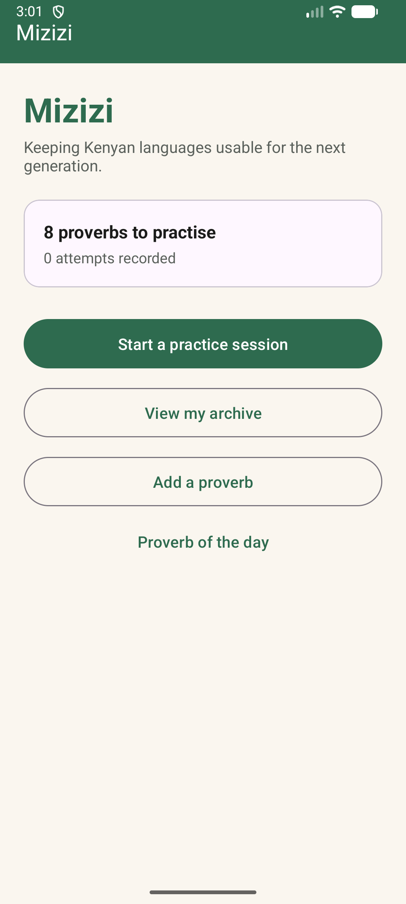
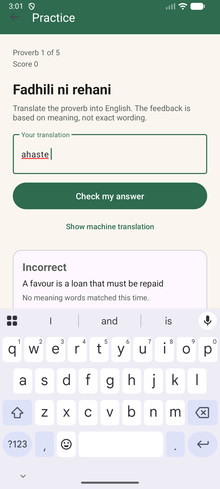
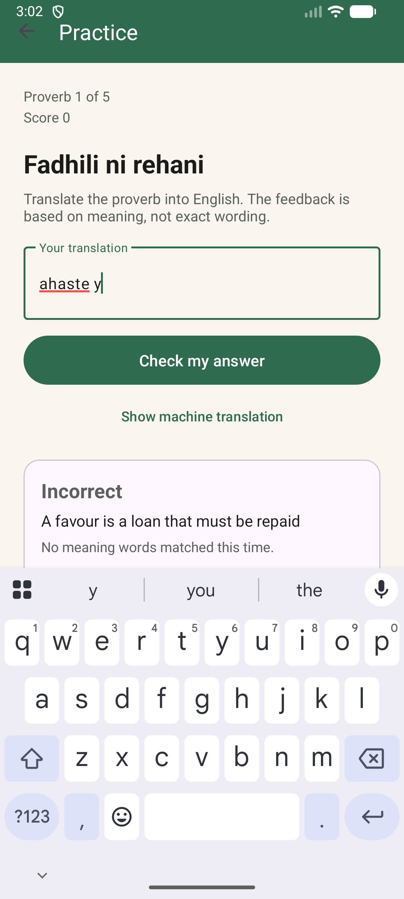
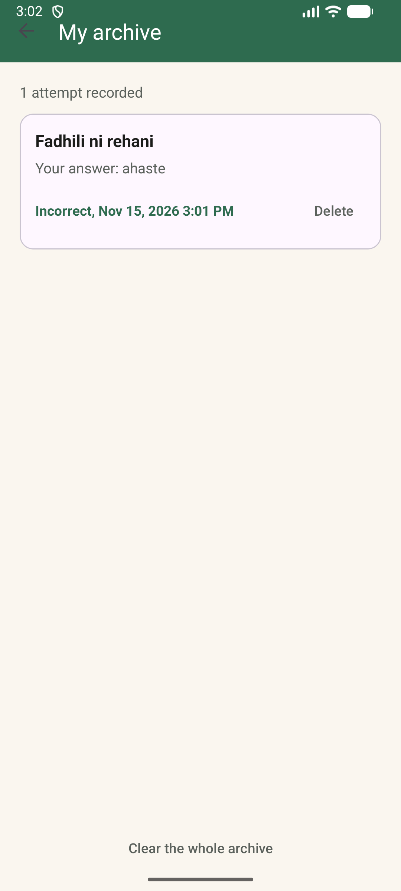
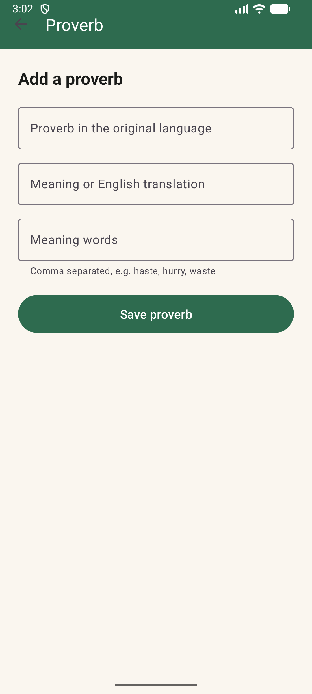
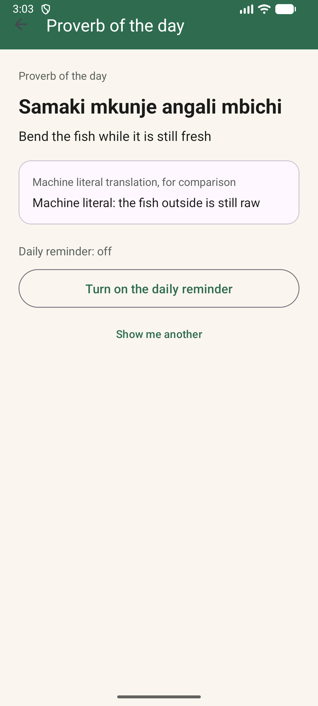
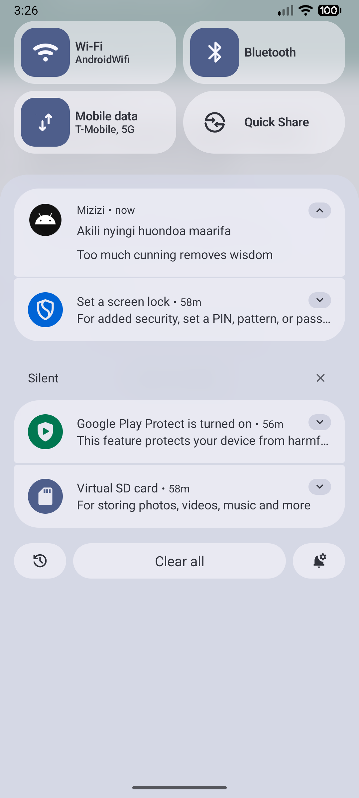

<h1 align="center">Mizizi</h1>
<p align="center">
  <em>Keeping Kenyan languages usable for the next generation.</em>
  <br>
  <br>
  <a href="#current-status">Current Status</a> ·
  <a href="#repository-structure">Repository Structure</a> ·
  <a href="#branching-rules">Branching Rules</a> ·
  <a href="#checks">Checks</a> ·
  <a href="#how-to-run-lab-1">How to Run</a> ·
  <a href="#team">Team</a> ·
  <a href="#concept-note">Concept Note</a>
  <br>
  
  
  
</p>

---

Mizizi is a language-practice application that lets users actively practise
translating words, phrases and proverbs in their mother tongue, and get
meaning-based feedback on their attempts, instead of a blind literal translation.

## Current status

- **Lab 1:** a console-based Kotlin prototype of the core feature, kept in
  `Main.kt` for the record: a proverb practice engine with meaning-based
  grading, a session score, an archive of attempts and a daily proverb.
- **CAT 2:** the Android application, in `app/`. Same idea, real UI, Room
  persistence, navigation, a translation API and a background reminder.

## What the app does

| Screen | What happens there |
|---|---|
| Home | Counts of proverbs and attempts, and the way in to everything else |
| Practice | One proverb at a time, an answer box, meaning-based grade, session score |
| Result | The grade, your answer, the real meaning, which meaning words you hit, and the machine's literal translation for comparison |
| Archive | Every attempt, newest first, with delete and clear-all |
| Proverb editor | Create a proverb, edit one, delete one, with validation |
| Proverb of the day | A daily proverb, its translation, and the daily reminder switch |









## Download

The signed APK is attached to the [v1.0 release](https://github.com/Allan-Ngugi-Nganga/Mizizi/releases/latest).
Install it on Android 7.0 (API 24) or newer, allow installs from the app you
open it with, and the app seeds itself with eight proverbs on first launch.

## Architecture and data flow

The app uses the layering the course asks for, and each layer has one job:

```
Fragment (UI)
    ↓ observes LiveData, sends user actions
MiziziViewModel (business logic, session state)
    ↓
MiziziRepository (the only door into the data layer)
    ↓                           ↓
Room database            MyMemory translation API
(proverbs, attempts)     (literal translation hint)
```

- **UI:** Fragments inflate View Binding layouts, collect input and call the
  ViewModel. They never talk to Room or the network.
- **ViewModel:** owns the practice session (which proverb, score), grades
  attempts through `domain/Grader.kt`, validates the proverb form, and exposes
  LiveData the screens observe.
- **Repository:** decides whether a request goes to the database or the API,
  and keeps the two away from the UI.
- **Data sources:** Room for proverbs and attempts, MyMemory over HTTPS for the
  machine translation.

A graded attempt therefore travels: answer in the Fragment, grade in the
ViewModel, insert through the Repository, row in Room, and the same LiveData
re-emits so Home and Archive update without the screens asking again.

## CRUD and persistence

| Operation | Where | How |
|---|---|---|
| Create | Proverb editor | `ProverbDao.insert`, auto-generated id |
| Read | Home, Practice, Archive, daily proverb | LiveData from `ProverbDao.observeAll` and `AttemptDao.observeAll` |
| Update | Proverb editor opened with a proverb id | `ProverbDao.update` on the same row |
| Delete | Proverb editor, Archive row, clear-all | `ProverbDao.delete`, `AttemptDao.deleteById` |

Room stores two tables. `proverbs` holds the text, meaning and comma separated
meaning words; `attempts` holds a copy of the proverb text, the answer, the
grade and a timestamp, so the archive still reads correctly after a proverb is
edited or deleted. Data survives the app being closed: reopen it and the counts
and archive are still there.

## API and background work

- **API:** `https://api.mymemory.translated.net/get?q=...&langpair=sw|en`. The
  response is parsed from `responseData.translatedText`, failures come back as a
  sealed `ApiResult` and are shown as messages rather than crashes, and the
  screen shows a progress indicator while the call is in flight.
- **Background:** `DailyProverbWorker` is a `CoroutineWorker` scheduled as a
  periodic WorkManager request (once a day). WorkManager is the right fit
  because the reminder must survive the app being closed and the device
  rebooting, and the system is allowed to delay a daily notification to save
  battery. It posts into a `daily_proverb` notification channel and asks for
  `POST_NOTIFICATIONS` on Android 13 and newer. The first reminder arrives soon
  after the switch is turned on, then repeats daily. The last screenshot above
  is the delivered notification.

## Repository structure

```
Mizizi/
├── app/                 # The Android application (CAT 2)
│   └── src/main/java/com/example/mizizi/
│       ├── data/        # Room entities, DAOs, database, repository, API client
│       ├── domain/      # Grader: pure Kotlin grading rules
│       ├── ui/          # Fragments, adapter, ViewModel
│       └── work/        # DailyProverbWorker and the notification channel
├── Main.kt              # Lab 1 console prototype (single-file submission)
├── README.md            # This file
├── CONTRIBUTING.md      # Branch, commit and PR conventions
├── docs/
│   ├── concept-note.md  # Concept note (mirror of the Google Doc)
│   ├── release-checklist.md
│   └── screenshots/     # Screens captured from the signed build
└── .gitignore
```

## Branching rules

| Branch                | Purpose                                                      | Who pushes |
|-----------------------|--------------------------------------------------------------|------------|
| `main`                | Demo/submission-ready code. Protected: no direct pushes.    | No one     |
| `develop`             | Integration branch. Features merge here via PR.              | No one     |
| `feature/<name>`      | New work, e.g. `feature/proverb-practice`                    | Everyone   |
| `hotfix/<name>`       | Urgent fixes straight to `main` (rare)                       | Everyone   |

## Commit rules (Conventional Commits)

- `feat:` - new functionality
- `fix:` - bug fix
- `docs:` - documentation only
- `refactor:` - code change with no behaviour change
- `chore:` - tooling, config, housekeeping

Keep commits **small and frequent** (one commit = one logical change).
Push at least once a day: frequent small commits make bugs easy to trace
and let the whole team follow updates as they happen.

## Checks

CI is paused while the project moves to the Android app, and the Gradle build
will bring its own checks back when the app scaffold lands. Until then, check
your work locally before you open a pull request:

```bash
kotlinc Main.kt -include-runtime -d mizizi.jar
java -jar mizizi.jar
```

Walk the practice session, the archive and the daily proverb before you push.

`main` is protected: code lands only through a pull request with at least one
approving review. No direct pushes, no force-pushes. See
`.github/PULL_REQUEST_TEMPLATE.md`.

## How to run

Android app (needs JDK 17 or newer and the Android SDK):

```bash
./gradlew assembleDebug
./gradlew installDebug     # with an emulator or device attached
```

Or open the project in Android Studio and press Run. The app seeds itself with
eight proverbs on first launch, so it is usable immediately.

Console prototype from Lab 1, kept for reference:

```bash
kotlinc Main.kt -include-runtime -d mizizi.jar && java -jar mizizi.jar
```

## Team and contributions

Every member built a slice of the Android app and committed it themselves.

| Member | Admission No. | Commit | Slice |
|---|---|---|---|
| Allan Ngugi | 191250 | `423bece` | Project setup, data layer (Room, repository, translation client), ViewModel, grading rules, navigation shell, Home screen |
| Ziki Mtula | 192992 | `2bed260` | Practice screen: question flow, answer input, inline grade, session score |
| Michael Asingwire | 192483 | `e6c095a` | Result screen: Safe Args, grade colours, meaning words matched, machine translation card |
| Kelly Wambui | 190500 | `80c773c` | Archive: RecyclerView with diffing adapter, delete and clear-all with confirmation, empty state |
| Daniella Thande | 152581 | `b6ccdc3` | Proverb editor: create and update in one form, delete, inline validation |
| Evelyn Mwangi | 190051 | `c549827` | Daily proverb, MyMemory integration with loading and error states, WorkManager reminder |
| Daniel Karanja | 180761 | `36a31b2` | README, screenshots, signing and release |

Each member's slice landed as its own commit. The slices were then assembled
through two pull requests: one into `develop`, and one from `release/v1.0` into
`main` for the release.

## Tests

`domain/Grader.kt` holds the grading rules as pure Kotlin so they can be tested
without Android. Nine unit tests in `app/src/test` cover exact matches,
punctuation and casing, keyword majorities, close attempts, blank answers and
normalisation.

```bash
./gradlew testDebugUnitTest
```

## Concept note

See [`docs/concept-note.md`](docs/concept-note.md). The Google Docs version
is linked at the top of `Main.kt` (required by the assignment).
